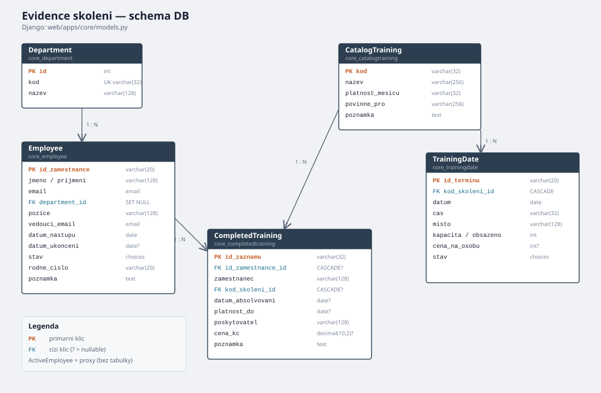
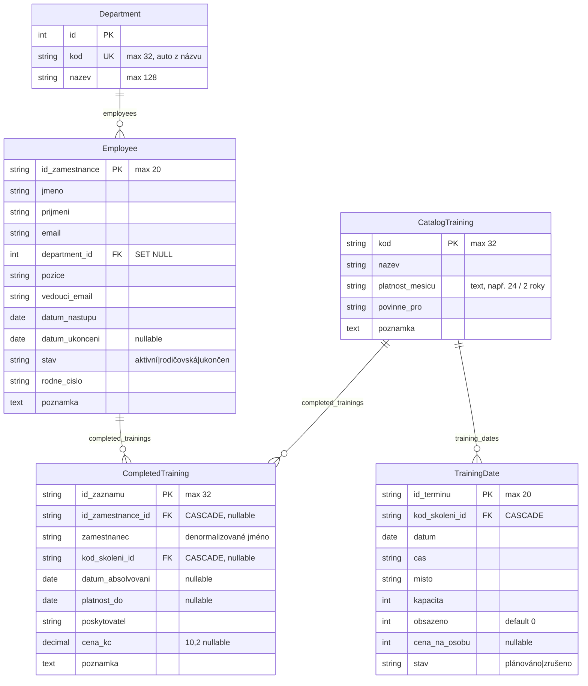

# Schéma databáze

Zdroj: Django modely v `web/apps/core/models.py`.

## Tabulky a vazby

| Model (tabulka) | PK | Vztahy |
|-----------------|----|--------|
| **Department** (`core_department`) | `id` (auto) | ← `Employee.department` |
| **Employee** (`core_employee`) | `id_zamestnance` | → Department (`SET NULL`); ← CompletedTraining |
| **CatalogTraining** (`core_catalogtraining`) | `kod` | ← TrainingDate, CompletedTraining |
| **TrainingDate** (`core_trainingdate`) | `id_terminu` | → CatalogTraining (`CASCADE`) |
| **CompletedTraining** (`core_completedtraining`) | `id_zaznamu` | → Employee (`CASCADE`, nullable), → CatalogTraining (`CASCADE`, nullable) |

`ActiveEmployee` je jen **proxy** nad `Employee` (filtr `stav=aktivní`) — žádná nová tabulka.

## Poznámky k návrhu

- Útvar se při ukládání dopočítá z názvu (`kod_from_nazev`), pokud `kod` chybí.
- U zaměstnance se při `save` normalizuje jméno/příjmení a e-maily.
- `CompletedTraining.zamestnanec` drží denormalizované jméno z CSV; FK na zaměstnance může být prázdná (neznámá ID typu `E900x`).
- `platnost_mesicu` v katalogu je text; numerický výklad je v property `platnost_mesicu_int`.
